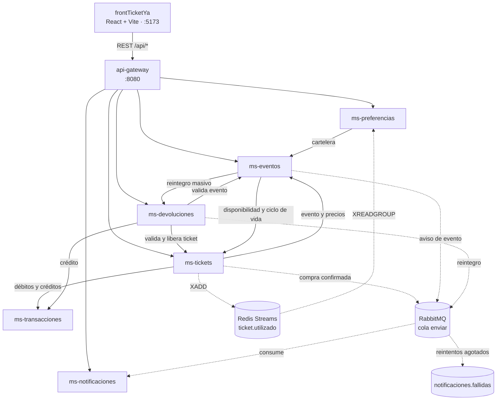
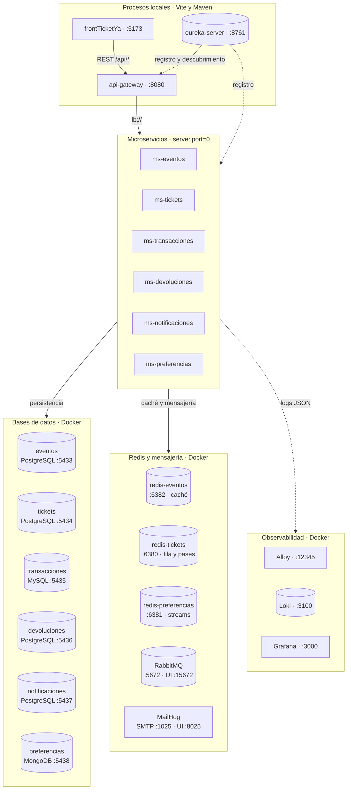

# 🎟️ TicketYa — Documentación de Arquitectura y Diseño

**Trabajo Práctico Especial de Arquitectura Web — TUDAI — 2026**


*Plataforma distribuida de venta de entradas construida bajo una arquitectura de microservicios.*

</div>

---

**TicketYa** es una plataforma de venta de entradas diseñada como un sistema distribuido de microservicios. Permite publicar y administrar eventos, gestionar filas virtuales de alta demanda, reservar y pagar entradas con tolerancia a fallos, controlar accesos mediante códigos QR firmados, gestionar devoluciones individuales o masivas, enviar notificaciones asíncronas y ofrecer recomendaciones personalizadas.

> 📄 **Alcance del documento:** Presenta la arquitectura implementada, los módulos del sistema, los flujos críticos de negocio, la infraestructura, la observabilidad y las principales decisiones de diseño del repositorio `TPE-TicketYa`.

---

## 📑 Tabla de Contenidos

- [1. Resumen Ejecutivo](#1-resumen-ejecutivo)
- [2. Objetivos y Reglas de Arquitectura](#2-objetivos-y-reglas-de-arquitectura)
- [3. Stack Tecnológico](#3-stack-tecnológico)
- [4. Arquitectura General](#4-arquitectura-general)
- [5. Estructura del Repositorio](#5-estructura-del-repositorio)
- [6. Microservicios de Negocio](#6-microservicios-de-negocio)
- [7. Flujos Críticos](#7-flujos-críticos)
- [8. Persistencia y Almacenamiento](#8-persistencia-y-almacenamiento)
- [9. Infraestructura y Observabilidad](#9-infraestructura-y-observabilidad)
- [10. Seguridad y Trazabilidad](#10-seguridad-y-trazabilidad)
- [11. Guía de Ejecución](#11-guía-de-ejecución)
- [12. Decisiones de Diseño](#12-decisiones-de-diseño)

---

## 1. Resumen Ejecutivo

### Componentes de la Solución

*  **6 Microservicios de negocio:** Eventos, Tickets, Transacciones, Devoluciones, Notificaciones y Preferencias.
*  **API Gateway & Discovery:** Punto de entrada único (`api-gateway`) respaldado por **Netflix Eureka** para descubrimiento dinámico de instancias.
*  **Frontend SPA:** Aplicación en React para clientes, organizadores y administradores.
*  **Database-per-Service:** Bases de datos independientes según las necesidades de cada dominio (PostgreSQL, MySQL y MongoDB).
*  **Redis:** Caché distribuida, fila virtual de alta demanda, pases temporales, streams de eventos e idempotencia.
*  **Mensajería & Correo:** **RabbitMQ** para notificaciones asíncronas (con reintentos exponenciales y DLQ) y **MailHog** como servidor SMTP de pruebas.
*  **Observabilidad:** Stack completo con **Loki, Alloy y Grafana** para logs estructurados en JSON y métricas operativas.

### Roles Soportados

| Rol | Capacidades Principales | Soporte UI |
| :--- | :--- | :---: |
| **`CLIENTE`** | Buscar eventos, reservar, pagar, ver entradas/QR, gestionar preferencias e historial. | ✅ |
| **`ORGANIZADOR`** | Crear eventos, definir sectores y precios, publicar y consultar reportes. | ✅ |
| **`ADMINISTRADOR`** | Crear lugares y sectores, cancelar, suspender, reactivar eventos y aprobar devoluciones. | ✅ |
| **`PERSONAL_ACCESO`** | Validar códigos QR de entrada en puerta. | ⚙️ *(Solo Backend)* |

> **Autenticación:** La identidad de usuario viaja mediante los headers HTTP `X-User-Id` y `X-User-Role`, seleccionables desde la interfaz de usuario.

---

## 2. Objetivos y Reglas de Arquitectura

### Reglas Estrictas del Proyecto
1. **Desacoplamiento de código:** Ningún módulo `ms-*` depende de otro `ms-*` como dependencia Maven.
2. **Comunicación estandarizada:** Toda interacción ocurre mediante contratos OpenAPI generados, clientes HTTP/Feign o mensajería asíncrona.
3. **Librerías limpias:** Los módulos compartidos (`libs/`) contienen exclusivamente infraestructura transversal, sin lógica de negocio.

### Objetivos Técnicos y Funcionales
*  **Prevención de doble venta:** Bloqueos pesimistas en base de datos, claves únicas y scripts Lua atómicos en Redis.
*  **Desacople de notificaciones:** Separación estricta entre la confirmación de compra y el envío de correos para que fallos en RabbitMQ o SMTP no bloqueen ventas válidas.
*  **Idempotencia transversal:** Garantizada en pagos, notificaciones, devoluciones e historial de consumo.
*  **Escalabilidad horizontal:** Soporte para múltiples instancias por microservicio mediante puertos efímeros (`server.port=0`) y locks distribuidos en jobs.
*  **Trazabilidad extremo a extremo:** Propagación de `X-Correlation-Id` y centralización de logs JSON en Grafana.

---

## 3. Stack Tecnológico

| Capa | Tecnologías |
| :--- | :--- |
| **Lenguaje & Build** | Java 25, Maven 3.9+ (Multi-módulo) |
| **Framework Backend** | Spring Boot 3.5.10, Spring Cloud 2025.0.1 |
| **Comunicación & Gateway** | Spring Cloud Gateway (WebFlux), Spring Cloud OpenFeign, Netflix Eureka |
| **Contratos API** | OpenAPI 3 + `openapi-generator-maven-plugin` 7.16.0 |
| **Persistencia Relacional** | PostgreSQL 18, MySQL 8.0, Spring Data JPA, Liquibase |
| **Persistencia Documental** | MongoDB 7, Spring Data MongoDB |
| **Caché, Colas & Streams** | Redis 7, Redisson, Scripts Lua, RabbitMQ 4 Management, Spring AMQP |
| **Resiliencia & Correo** | Resilience4j *(Retry, Circuit Breaker, Time Limiter)*, DLQ, Outbox parcial, JavaMailSender + MailHog |
| **Frontend** | React 19, Vite 8, TypeScript 7, React Router 7, TanStack Query 5, oxlint |
| **Observabilidad** | Logback (`logstash-logback-encoder`), Loki, Alloy, Grafana |

---

## 4. Arquitectura General

La comunicación del sistema sigue un modelo híbrido que combina llamadas síncronas (REST/Feign) para operaciones transaccionales inmediatas y mensajería asíncrona (RabbitMQ y Redis Streams) para desacoplar procesos secundarios:

**Comunicación síncrona y asíncrona.**



> **Leyenda:** línea sólida = HTTP síncrono (Gateway o Feign); línea punteada = mensajería asíncrona. El Gateway resuelve las instancias con `lb://` a través de Eureka. `ms-transacciones` no tiene ruta pública: solo se invoca por Feign desde `ms-tickets` y `ms-devoluciones`.

> **Consultas de notificaciones:** para armar cada correo, `ms-notificaciones` consulta por Feign a `ms-eventos` (datos del evento), `ms-tickets` (compradores) y `ms-preferencias` (destinatarios).

**Despliegue de la infraestructura.**



> Las bases, Redis, RabbitMQ, MailHog y la observabilidad corren en `infra/docker-compose.yml`; el front, el gateway, Eureka y los microservicios se ejecutan como procesos locales. Cada servicio tiene su propia base y no hay claves foráneas cruzadas (detalle en §8). Alloy recolecta los `logs/<servicio>/*.json.log` de todos los servicios y los envía a Loki; Grafana consulta Loki.

* **Punto de entrada:** El frontend (`frontTicketYa` en `:5173`) redirige todas las peticiones `/api/*` al `api-gateway` (`:8080`), el cual enruta dinámicamente consultando a `eureka-server` (`:8761`).
* **Servicios expuestos:** El Gateway enruta hacia `ms-eventos`, `ms-tickets`, `ms-devoluciones`, `ms-notificaciones` y `ms-preferencias`.
* **Servicios internos:** `ms-transacciones` carece de ruta pública en el Gateway; opera exclusivamente como servicio interno consumido vía Feign por `ms-tickets` y `ms-devoluciones`.
* **Protección de rutas:** Los prefijos `/api/eventos/internal/**`, `/api/tickets/internal/**` y `/api/preferencias/internal/**` son bloqueados por el Gateway devolviendo `404 Not Found` para evitar su exposición externa.
* **Bus de eventos y caché:** RabbitMQ gestiona la cola `enviar` para notificaciones por correo (vía MailHog), mientras que Redis actúa como caché de catálogo (`redis-eventos`), motor de fila virtual (`redis-tickets`) y bus de streams (`redis-preferencias`).
* **Instancias dinámicas:** Todos los microservicios utilizan `server.port=0` e IDs de instancia únicos, permitiendo levantar múltiples réplicas compartiendo la misma base de datos.

---

## 5. Estructura del Repositorio

```text
TPE-TicketYa/
├── api-gateway/        # Enrutamiento, filtros de correlación, bloqueo interno y manejo de errores
├── contracts/          # 6 módulos OpenAPI (eventos, tickets, transacciones, devoluciones, preferencias, notificaciones)
├── docs/               # Decisiones de diseño y runbooks operativos
├── eureka-server/      # Servidor de descubrimiento de servicios
├── frontTicketYa/      # Aplicación SPA en React + Vite + TypeScript
├── infra/              # Docker Compose, configuraciones de Alloy, Loki, Grafana y .env.example
├── libs/               # Librerías transversales: ticketya-core, web-starter, persistence, logging
├── ms-devoluciones/    # Gestión de devoluciones individuales y reintegros masivos
├── ms-eventos/         # Catálogo de eventos, lugares, sectores, precios y ciclo de vida
├── ms-notificaciones/  # Consumidor RabbitMQ, resolución de destinatarios, plantillas y SMTP
├── ms-preferencias/    # Gustos declarados, historial de consumo, co-compras y recomendaciones
├── ms-tickets/         # Disponibilidad, reservas, saga de pago, emisión, QR, accesos y fila virtual
├── ms-transacciones/   # Débitos y créditos contra pasarela de pago con resiliencia
└── postman/            # Colecciones de integración de los microservicios
```

---

## 6. Microservicios de Negocio

### 6.1 `ms-eventos` — Catálogo y Ciclo de Vida

**Responsabilidad:** Administrar eventos, lugares, sectores, participantes y precios; gestionar los estados del ciclo de vida (`BORRADOR`, `PUBLICADO`, `SUSPENDIDO`, `AGOTADO`, `CANCELADO`, `FINALIZADO`).

**Entidades principales:** `Evento`, `Lugar`, `Sector`, `SectorNumerado`, `SectorNoNumerado`, `Participante`, `EventoNotificacion` *(tabla outbox)*.

| Método | Endpoint | Propósito |
| :--- | :--- | :--- |
| `GET` | `/api/eventos` | Listado con filtros, ordenamiento y paginación. |
| `GET` | `/api/eventos/{eventoId}` | Detalle del evento. |
| `POST` | `/api/eventos` | Crear borrador (`ORGANIZADOR`). |
| `PUT` | `/api/eventos/{eventoId}` | Editar datos del evento. |
| `PUT` | `/api/eventos/{id}/publicar` | Publicar evento. |
| `PUT` | `/api/eventos/{id}/suspender` | Suspender evento. |
| `PUT` | `/api/eventos/{id}/reactivar` | Reactivar evento suspendido. |
| `POST` | `/api/eventos/{id}/cancelar` | Cancelar evento y disparar reintegro masivo. |
| `PUT` | `/api/eventos/{id}/sectores/{sectorId}/precio` | Configurar precio por sector. |
| `DELETE` | `/api/eventos/{eventoId}` | Eliminar borrador. |
| `GET` / `POST` | `/api/lugares` | Listar o registrar recintos/lugares. |
| `POST` | `/api/lugares/{lugarId}/sectores/numerados` | Crear sector con butacas numeradas. |
| `POST` | `/api/lugares/{lugarId}/sectores/no-numerados` | Crear sector general por cupo. |
| `PUT` | `/api/eventos/internal/{id}/estado/agotado` | *(Interno)* Marcar evento como agotado. |
| `PUT` | `/api/eventos/internal/{id}/estado/publicar` | *(Interno)* Volver a estado publicado. |
| `PUT` | `/api/eventos/internal/finalizar-vencidos` | *(Interno)* Finalizar eventos pasados. |

* **Integraciones:** Invoca vía Feign a `ms-tickets` (disponibilidad y cambios de estado) y `ms-devoluciones` (reintegro masivo). Publica eventos en RabbitMQ (`PUBLICACION_ARTISTA`, `CANCELACION`, `EDICION`, `SUSPENSION`).
* **Outbox & Schedulers:** Utiliza la tabla outbox `evento_notificacion` para notificar `FINALIZAR` hacia `ms-tickets` (relay cada 60 s, lotes de 50, hasta 5 intentos con backoff `60/300/900/3600 s`). Incluye un scheduler de finalización cada 15 min (`0 */15 * * * *`) con 6 h de gracia y **ShedLock**.
* **Caché:** Redisson sobre `redis-eventos:6382`. Almacena `evento-detalle` (TTL 5 min con invalidación en mutaciones) y `evento-busqueda` (TTL 30 s). Es tolerante a fallos: ante caída de Redis, consulta directamente PostgreSQL.

---

### 6.2 `ms-tickets` — Core de Ventas, QR y Fila Virtual

**Responsabilidad:** Controlar disponibilidad, reservas, cobros, emisión de entradas, validación de QR, fila virtual y reportes. Actúa como **orquestador de la saga de compra**.

**Entidades principales:** `DisponibilidadEvento`, `DisponibilidadSector`, `DisponibilidadAsiento`, `Reserva`, `Ticket`, `Venta`, `VentaItem`, `HabilitacionEvento`, `BloqueoJob`.

* **Estados de Reserva:** `PENDIENTE_PAGO`, `APROBADO`, `RECHAZADO`, `REINTEGRADO`, `REINTEGRO_PENDIENTE`.
* **Estados de Ticket:** `RESERVADO`, `PENDIENTE_PAGO`, `EMITIDO`, `VENDIDO`, `USADO`, `DEVUELTO`, `CANCELADO`, `EXPIRADO`, `LIBERADO`.
* **Estados de Venta:** `ABIERTA`, `AGOTADA`, `SUSPENDIDA`, `CANCELADA`.

| Método | Endpoint | Propósito |
| :--- | :--- | :--- |
| `POST` / `GET` | `/api/tickets/eventos/{eventoId}/disponibilidad` | Publicar o consultar disponibilidad. |
| `POST` | `/api/tickets/eventos/{eventoId}/reservas` | Crear reserva temporal. |
| `POST` | `/api/tickets/reservas/{reservaId}/pago` | Ejecutar pago (requiere `Idempotency-Key`). |
| `GET` | `/api/tickets/mis-entradas` | Listar entradas adquiridas por el cliente. |
| `GET` | `/api/tickets/{ticketId}/qr` | Generar/obtener código QR firmado. |
| `POST` | `/api/tickets/eventos/{eventoId}/accesos/validar` | Validar QR en puerta. |
| `POST` / `GET` / `DELETE` | `/api/tickets/eventos/{eventoId}/fila` | Ingresar, consultar posición o salir de fila virtual. |
| `GET` | `/api/tickets/reportes/eventos/{id}/{entradas\|ocupacion\|recaudacion}` | Reportes operativos para organizadores. |

* **Mecanismos clave:** Idempotencia por `(cliente, Idempotency-Key)`; bloqueos pesimistas en reservas y pagos; jobs distribuidos (liberación de reservas cada 30 s, reconciliación de pagos cada 1 min, habilitación de tandas cada 5 s); firma HMAC en códigos QR (`TICKETS_QR_SECRET`); publicación en Redis Stream (`ticket.utilizado`) y RabbitMQ (`CONFIRMACION_COMPRA`).

---

### 6.3 `ms-transacciones` — Pasarela Resiliente

**Responsabilidad:** Ejecutar y registrar débitos y créditos contra la pasarela de pagos con garantías de idempotencia y tolerancia a fallos.

**Entidad:** `Transaccion` (`tipo`, `estado`, `monto`, `clienteId`, `organizadorId`, `ticketId`, `motivoFallo`).

| Método | Endpoint | Propósito |
| :--- | :--- | :--- |
| `POST` | `/api/transacciones/debitos` | Registrar débito de compra. |
| `POST` | `/api/transacciones/creditos` | Registrar crédito/reintegro. |
| `GET` | `/api/transacciones/{id}` | Consultar transacción por ID. |
| `GET` | `/api/transacciones/ticket/{ticketId}` | Consultar transacciones asociadas a un ticket. |
| `GET` | `/api/transacciones/organizador/{organizadorId}` | Listar movimientos por organizador. |

* **Patrones de Resiliencia:** `Propagation.NOT_SUPPORTED` en `TransaccionService.crear` para evitar retener conexiones de base de datos durante llamadas externas. `PasarelaResiliente` encadena `CircuitBreaker`, `Retry` y `TimeLimiter` sobre *virtual threads*.
* **Configuración:** Circuit Breaker (ventana de 20 llamadas, mínimo 5, umbral 50 %, espera 30 s, 3 pruebas en semiabierto); Pasarela (timeout 2 s por intento, 3 intentos, backoff 200/400 ms). Responde `409 Conflict` si se reutiliza una clave de idempotencia con parámetros distintos.

---

### 6.4 `ms-devoluciones` — Reintegros Individuales y Masivos

**Responsabilidad:** Gestionar solicitudes de devolución de clientes, auditoría administrativa y reintegros masivos por cancelación de eventos.

**Entidades:** `Devolucion` y `ReintegroMasivo`.

| Método | Endpoint | Propósito |
| :--- | :--- | :--- |
| `POST` | `/api/devoluciones` | Solicitar devolución individual. |
| `GET` | `/api/devoluciones` | Listar solicitudes. |
| `GET` | `/api/devoluciones/{id}` | Obtener detalle. |
| `GET` | `/api/devoluciones/ticket/{ticketId}` | Consultar estado por ticket. |
| `POST` | `/api/devoluciones/{id}/{aprobar\|rechazar}` | Resolución administrativa (`ADMINISTRADOR`). |
| `PUT` | `/api/devoluciones/eventos/{eventoId}/reintegro-masivo` | *(Interno)* Disparar reintegro masivo por cancelación. |

* **Reglas de negocio:** Antelación mínima de **72 horas** antes del evento; ticket en estado `EMITIDO` o `VENDIDO`; índice único parcial sobre `(cliente_id, ticket_id)` para estados `PENDIENTE` y `APROBADA`. Si el crédito falla al aprobar, marca `reintegroPendiente: true`.

---

### 6.5 `ms-notificaciones` — Motor Asíncrono de Correos

**Responsabilidad:** Consumir mensajes de RabbitMQ, resolver destinatarios dinámicamente, renderizar plantillas y enviar correos con manejo de errores y DLQ.

* **Entrada:** Sin API REST pública; escucha la cola `enviar` mediante `NotificacionListener`.
* **Motivos soportados:** `CANCELACION`, `CONFIRMACION_COMPRA`, `PUBLICACION_ARTISTA`, `EDICION`, `SUSPENSION`.
* **Idempotencia:** Clave compuesta `(mensajeId, destinatarioId)`.
* **Resolvedores:** `CompradoresEventoResolver` (consulta `ms-tickets`) y `PreferenciasArtistaResolver` (consulta `ms-preferencias` en lotes de hasta 100 IDs).
* **Política de Reintentos y DLQ:** 8 reintentos exponenciales (`5s → 10s → 20s → 40s → 80s → 160s → 300s → 300s`). Direcciones inválidas pasan a `NO_ENTREGABLE`. Agotados los reintentos, `NotificacionDlqRecoverer` marca `FALLIDO` y enruta vía `enviar.dlx` a `notificaciones.fallidas`. Timeouts SMTP: 2 s conexión / 5 s lectura-escritura.

---

### 6.6 `ms-preferencias` — Perfilado y Recomendaciones

**Responsabilidad:** Almacenar gustos declarados, construir historial de consumo vía streams y calcular recomendaciones personalizadas.

**Colecciones MongoDB:** `preferencias` (`_id = clienteId`) y `co_compras` (pares de eventos co-ocurridos).

| Método | Endpoint | Propósito |
| :--- | :--- | :--- |
| `GET` / `PUT` | `/api/preferencias/mias` | Consultar o reemplazar gustos declarados (con deduplicación). |
| `GET` | `/api/preferencias/historial` | Obtener historial de eventos comprados/asistidos. |
| `GET` | `/api/recomendaciones` | Obtener top 10 de eventos recomendados. |
| `GET` | `/api/preferencias/internal/destinatarios` | *(Interno)* Resolver interesados por artista y ciudad. |

* **Streams & Scoring:** Consume `venta.pagada` y `ticket.utilizado` desde Redis Streams con deduplicación por 7 días (`preferencias:historial:procesados:<stream>:<id>`). Algoritmo de puntaje: **Artista (+5)**, **Tipo (+3)**, **Co-ocurrencia (+1 a +3)**, **Ciudad (+1)**. Ante fallo de `ms-eventos`, retorna `200 []` como fallback seguro.

---

## 7. Flujos Críticos

### 7.1 Saga de Compra Orquestada

La compra es coordinada por `PagoService` (`ms-tickets`) mediante transacciones locales y acciones compensatorias explícitas (sin transacciones distribuidas 2PC):

1. **Inicio y bloqueo:** El cliente envía `POST /api/tickets/reservas/{id}/pago` con su `Idempotency-Key`. `ms-tickets` bloquea la reserva mediante lock pesimista.
2. **Cobro por ticket:** Por cada ticket de la reserva, `ms-tickets` invoca `POST /api/transacciones/debitos` en `ms-transacciones`.
3. **Confirmación exitosa:** Si todos los débitos retornan `COMPLETA`, `ms-tickets` emite los tickets, genera los QR firmados, marca la reserva como `APROBADO`, responde `201 Created` y agenda la notificación en RabbitMQ (`AFTER_COMMIT`).

#### Matriz de Compensaciones y Reconciliación

| Escenario | Acción Ejecutada | Estado Final | HTTP |
| :--- | :--- | :--- | :---: |
| Débito `FALLIDA` | Reintegrar débitos previos aprobados y liberar cupos. | `RECHAZADO` | `409` |
| Error de emisión post-cobro | Reintegrar todos los débitos y liberar reserva. | `REINTEGRADO` | `409` |
| Fallo en crédito compensatorio | Liberar reserva y escalar para resolución manual. | `REINTEGRO_PENDIENTE` | `409` |
| Timeout / 5xx / `PENDIENTE` | Mantener reserva en espera para reconciliación periódica. | `PENDIENTE_PAGO` | `202` |

> **Reconciliación automática:** `ReconciliacionPagoJob` se ejecuta cada minuto bajo lock distribuido (`reconciliar-pagos`), verificando el estado real en `ms-transacciones` (`GET /api/transacciones/ticket/{ticketId}?tipo=DEBITO`) para emitir, compensar o reintentar idempotentemente.

---

### 7.2 Fila Virtual de Alta Demanda

* **Activación:** Al publicar un evento de alta demanda, `ms-tickets` inicializa su configuración (`tamano_tanda`: 50, `intervalo_segundos`: 30 s, `ttl_pase_segundos`: 5 min).
* **Procesamiento atómico:** `HabilitacionTandaJob` (cron `*/5 * * * * *`) ejecuta scripts Lua en Redis para extraer usuarios (`ZPOPMIN`), emitir pases temporales (`PEXPIREAT`) y reciclar cupos vencidos.
* **Estructuras en Redis:**
  * `tickets:fila:evento:{eventoId}` → `ZSET` ordenado por timestamp de llegada.
  * `tickets:pase:evento:{eventoId}:cliente:{clienteId}` → `HASH` con TTL de compra.
  * `tickets:pases-activos:evento:{eventoId}` → `ZSET` indexado por expiración.
* **Consulta:** `GET /api/tickets/eventos/{eventoId}/fila` lee directamente desde Redis sin tocar PostgreSQL, informando estado (`EN_ESPERA` / `HABILITADO`), posición y personas delante.

---

### 7.3 Notificación Asíncrona de Compra

1. Al confirmarse la venta, `ms-tickets` dispara `CompraConfirmadaNotificacionEvent`.
2. `NotificacionCompraEventListener` captura el evento únicamente tras el commit exitoso (`@TransactionalEventListener(AFTER_COMMIT)`) y delega la tarea a `notificacionesAsyncExecutor` preservando el contexto MDC.
3. El executor publica el mensaje en la cola `enviar` de RabbitMQ con clave `mensajeId=MST-RESERVA-{reservaId}`.
4. `ms-notificaciones` consume el mensaje, verifica idempotencia por `(mensajeId, destinatarioId)` y realiza el envío SMTP. Ante errores transitorios, aplica backoff exponencial hasta derivar a la DLQ (`notificaciones.fallidas`).

---

### 7.4 Devoluciones y Reintegro Masivo

1. **Solicitud individual:** `ms-devoluciones` valida titularidad, ventana de 72 h y estado del ticket contra `ms-eventos` y `ms-tickets`.
2. **Aprobación:** Marca la solicitud como `APROBADA`, libera el asiento/cupo en `ms-tickets` y ejecuta el crédito en `ms-transacciones`.
3. **Cancelación masiva:** `ms-eventos` invoca `PUT /api/devoluciones/eventos/{eventoId}/reintegro-masivo`. Un job procesa lotes de compradores de forma atómica, gestiona reintentos y notifica cada reintegro vía RabbitMQ con `mensajeId` determinístico.

---

### 7.5 Historial y Recomendaciones

1. Al validar un QR en puerta, `ms-tickets` publica en el stream `ticket.utilizado`.
2. `ms-preferencias` consume los streams de actividad, actualizando el historial del usuario y la matriz de `co_compras` (con deduplicación por 7 días).
3. `GET /api/recomendaciones` cruza gustos declarados, historial, co-ocurrencias y cartelera activa de `ms-eventos` para rankear hasta 10 sugerencias personalizadas.

---

## 8. Persistencia y Almacenamiento

### Bases de Datos por Servicio

| Contenedor | Motor | Base de Datos | Puerto Host | Volumen Docker |
| :--- | :--- | :--- | :---: | :--- |
| `db-eventos` | PostgreSQL 18 | `eventos` | `5433` | `eventos-data` |
| `db-tickets` | PostgreSQL 18 | `tickets` | `5434` | `tickets-data` |
| `db-transacciones` | MySQL 8.0 | `transacciones` | `5435` | `transacciones-data` |
| `db-devoluciones` | PostgreSQL 18 | `devoluciones` | `5436` | `devoluciones-data` |
| `db-notificaciones` | PostgreSQL 18 | `notificaciones` | `5437` | `notificaciones-data` |
| `db-preferencias` | MongoDB 7 | `ticketya_preferencias` | `5438` | `preferencias-data` |

### Infraestructura en Memoria, Mensajería y Correo

| Contenedor | Imagen | Rol en la Arquitectura | Puerto(s) Host |
| :--- | :--- | :--- | :---: |
| `redis-tickets` | `redis:7-alpine` | Fila virtual, pases temporales y locks de habilitación. | `6380` |
| `redis-preferencias` | `redis:7-alpine` | Redis Streams de historial y deduplicación. | `6381` |
| `redis-eventos` | `redis:7-alpine` | Caché Redisson para detalle y búsqueda de eventos. | `6382` |
| `rabbitmq` | `rabbitmq:4-management` | Broker AMQP (cola `enviar`, `enviar.dlx`, `notificaciones.fallidas`). | `5672` / `15672` |
| `mailhog` | `mailhog/mailhog` | Servidor SMTP de pruebas e interfaz web de bandeja. | `1025` / `8025` |

> **Criterio de Caché:** Se cachea exclusivamente el catálogo de eventos (alta lectura, baja mutación, tolerante a consistencia eventual). **Nunca se cachean** disponibilidad, reservas, transacciones ni tickets para evitar doble venta o inconsistencias financieras. En `ms-tickets`, Redis opera como **fuente de verdad** de la fila virtual, no como caché.

---

## 9. Infraestructura y Observabilidad

### 9.1 Stack Docker Compose (`ticketya-infra`)

Definido en `infra/docker-compose.yml` con todos los puertos enlazados a `127.0.0.1`. Incluye el stack de observabilidad:

| Servicio | Imagen | Función | Puerto Host |
| :--- | :--- | :--- | :---: |
| `loki` | `grafana/loki:3.4.2` | Motor de almacenamiento e indexación de logs. | `3100` |
| `alloy` | `grafana/alloy:v1.8.3` | Recolector que lee `*.json.log` cada 5 s y etiqueta por `service`. | `12345` |
| `grafana` | `grafana/grafana:11.6.0` | Visualización, exploración y alertas (acceso anónimo Admin). | `3000` |

* **Dashboard preconfigurado:** **TicketYa - Logs** (`infra/grafana/provisioning/dashboards/`) con filtros dinámicos por `service` y `correlationId`, tasa de errores `5xx`, latencia `p95` por endpoint y visor de trazas.

### 9.2 Estrategia de Logging (`ticketya-logging`)

* **Consola:** Texto plano legible con formato `[SERVICE] [correlationId]`.
* **Archivo:** Formato JSON estructurado en `logs/<servicio>/<servicio>.json.log`.
* **Rotación:** Máximo `10 MB` por archivo, retención de `7 días` y tope global de `500 MB` (configurable vía propiedades `ticketya.logging.*`).

---

## 10. Seguridad y Trazabilidad

* **Control de Acceso (RBAC):** Anotación `@Authorize` + `AuthorizeInterceptor` evalúan `X-User-Role`. `HeaderUserContext` valida que `X-User-Id` sea numérico y el rol pertenezca al enum permitido. Las rutas `/internal/**` devuelven `404` en el Gateway.
* **Trazabilidad Distribuida:** El Gateway genera un UUID como `X-Correlation-Id` si no viene en la petición (o si no cumple `[A-Za-z0-9._-]{1,64}`), lo propaga en headers Feign, lo incluye en respuestas `ProblemDetail` y lo mantiene en hilos asíncronos mediante `MdcTaskDecorator`.
* **Integridad de Códigos QR:** Firmados con HMAC + Base64 URL usando `TICKETS_QR_SECRET`. `AccesoService.validar` verifica la firma criptográfica en memoria antes de consultar la base de datos, rechazando firmas alteradas con `400 Bad Request`.

---

## 11. Guía de Ejecución

### Prerrequisitos
* **JDK 25**, **Maven 3.9+**, **Docker & Docker Compose**, **Node.js 20+**.

### 1. Levantar Infraestructura y Compilar
```bash
cp infra/.env.example infra/.env
# Editar infra/.env completando contraseñas y secretos

docker compose -f infra/docker-compose.yml up -d
mvn install -DskipTests
```

### 2. Iniciar Servicios Core y Microservicios
```bash
# Núcleo de infraestructura Spring
mvn -pl eureka-server spring-boot:run
mvn -pl api-gateway spring-boot:run

# Microservicios de negocio (en terminales separadas)
env DB_PASSWORD=<password> mvn -pl ms-eventos spring-boot:run
env DB_PASSWORD=<password> TICKETS_QR_SECRET=<secreto-largo> mvn -pl ms-tickets spring-boot:run
env DB_PASSWORD=<password> mvn -pl ms-transacciones spring-boot:run
env DB_PASSWORD=<password> mvn -pl ms-devoluciones spring-boot:run
env DB_PASSWORD=<password> mvn -pl ms-notificaciones spring-boot:run # Requiere vars RABBITMQ_*
mvn -pl ms-preferencias spring-boot:run
```

> **Escalar múltiples instancias:** Basta con ejecutar nuevamente el comando `spring-boot:run` de cualquier microservicio en otra terminal (o activar *Allow multiple instances* en IntelliJ); cada réplica tomará un puerto aleatorio y se registrará en Eureka.

### 3. Iniciar Frontend SPA
```bash
cd frontTicketYa
npm install
npm run dev
```

### Accesos Rápidos

| Herramienta | URL Local | Notas |
| :--- | :--- | :--- |
| **Frontend TicketYa** | `http://localhost:5173` | Proxy automático `/api/*` hacia Gateway. |
| **API Gateway** | `http://localhost:8080` | Punto de entrada único REST. |
| **Eureka Dashboard** | `http://localhost:8761` | Estado de instancias registradas. |
| **Grafana (Logs & Métricas)** | `http://localhost:3000` | Dashboard: *TicketYa - Logs* (sin login). |
| **RabbitMQ Management** | `http://localhost:15672` | Monitoreo de colas `enviar` y DLQ. |
| **MailHog Web UI** | `http://localhost:8025` | Bandeja de correos interceptados. |

---

## 12. Decisiones de Diseño

| Decisión Arquitectónica | Justificación Técnica |
| :--- | :--- |
| **Database-per-Service** | Permite evolucionar esquemas de forma independiente (Liquibase en SQL, documentos en MongoDB) y elegir el motor óptimo por dominio. |
| **Contratos OpenAPI Generados** | Elimina dependencias de código entre microservicios; los clientes Feign y DTOs se generan automáticamente desde la especificación. |
| **Saga Orquestada en `ms-tickets`** | Garantiza consistencia local fuerte en cobros y compensaciones explícitas sin la complejidad ni bloqueos de transacciones distribuidas (XA). |
| **Publicación `AFTER_COMMIT`** | Evita emitir notificaciones de compras o cambios cuya transacción local terminó haciendo rollback. |
| **Executor Async con Cola Acotada** | Desacopla la latencia del request HTTP de compra frente a caídas de RabbitMQ/SMTP, preservando `X-Correlation-Id` vía `MdcTaskDecorator`. |
| **Idempotencia por Clave de Negocio** | Uso de `Idempotency-Key`, `mensajeId`, `tx-<id>` e índices únicos compuestos para tolerar reintentos de red sin efectos duplicados. |
| **Locks Distribuidos en BD** | Permite correr múltiples réplicas de cada servicio sin colisiones en jobs de reconciliación, expiración o tandas. |
| **Redis como Fuente de Verdad en Fila** | Garantiza operaciones atómicas (Lua) y latencia sub-milisegundo bajo picos de concurrencia; no se trata como caché volátil. |
| **Caché Selectiva de Catálogo** | Se cachean búsquedas y detalles tolerantes a consistencia eventual, excluyendo estrictamente disponibilidad y operaciones monetarias. |

> **Alternativas descartadas en notificaciones:** Envío SMTP síncrono en el hilo de pago; publicación pre-commit; `@Async` directo sin cola acotada; `CallerRunsPolicy` (devolvería la carga al hilo HTTP); y Outbox transaccional completo (se priorizó no bloquear la venta antes que garantizar entrega ante caída del broker).
